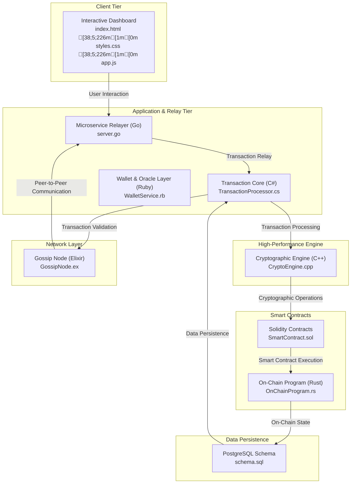
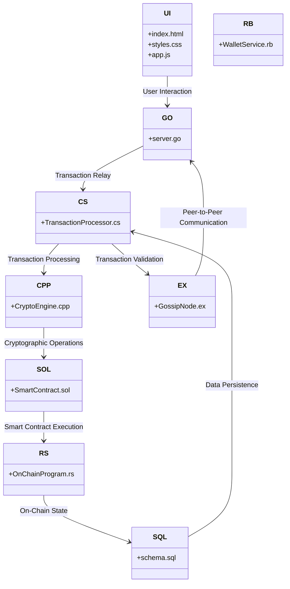

<div align="center">

# MAGNUM OPUS

### One repository. Eight languages. The entire Web3 stack.

*A multi-language, AI-assisted architectural showcase demonstrating how modern Web3, DeFi, and blockchain systems integrate across frontend, backend, engine, contract, and data layers.*

[](LICENSE)
[](#-project-status-read-this-first)
[](SECURITY.md)
[](#-automation-and-ai-agent-pipeline)
[](https://github.com/LinkHAckerman/MasterProject/actions)
[](https://github.com/LinkHAckerman/LinkHAckerman/blob/main/header.svg)


**[Live Dashboard Demo](https://linkhackerman.github.io/MasterProject/index.html)  Contribute](CONTRIBUTING.md)  Security](SECURITY.md)**

</div>

---

## Table of Contents

1. [Overview](#-overview)
2. [Project Status: Read This First](#-project-status-read-this-first)
3. [Architecture](#-architecture)
4. [Component Map](#-component-map)
5. [Quick Start](#-quick-start)
6. [Automation and AI Agent Pipeline](#-automation-and-ai-agent-pipeline)
7. [Repository Layout](#-repository-layout)
8. [Project Documents](#-project-documents)
9. [Known Limitations](#-known-limitations)
10. [Roadmap](#-roadmap)
11. [Contributing](#-contributing)
12. [License](#-license)

---

## Overview

**Magnum Opus** is an architectural reference implementation bringing together each tier of a Web3 platform into a single repository. Each component is authored in an idiomatic language suited for its specific workload and performance profile:

| Layer | Language | Source File | Role |
|---|---|---|---|
| **Frontend Dashboard** | HTML5 / CSS3 / JavaScript | `index.html`, `styles.css`, `app.js` | Dark-theme Web3 trading, staking, portfolio, and swap interface |
| **Core Ledger & Processing** | C# (.NET Core) | `TransactionProcessor.cs` | Transaction lifecycle validation, Merkle block generation, cryptographic receipts |
| **High-Performance Engine** | C++ (C++20) | `CryptoEngine.cpp` | SHA-256 computation, Merkle tree verification, AMM math, order-book matching |
| **Smart Contracts** | Solidity (0.8.24) | `SmartContract.sol` | Multi-token vault, AMM swap liquidity pools, yield staking, NFT badge logic |
| **Microservice Relayer** | Go (Golang) | `server.go` | Lightweight concurrent transaction relayer, wallet proxy, and WebSocket broadcaster |
| **Data Persistence** | PostgreSQL / SQL | `schema.sql` | Relational ledger schema for accounts, transactions, order books, and NFT metadata |
| **On-Chain Program** | Rust (Solana / Anchor) | `OnChainProgram.rs` | Memory-safe on-chain vault program with account state validation and instruction routing |
| **Glue & Oracle Layer** | Ruby | `WalletService.rb` | Balance aggregation, rate caching, mock oracles, and cross-tier transaction utilities |
| **Validation & Automation** | Python 3 | `validate_files.py`, `ai_agent*.py` | Multi-model agent pipeline and syntax validation test suite |

---

## Project Status: Read This First

Magnum Opus is an **educational and architectural demonstration**, not a commercial or production deployment:

- **Educational Reference:** Components are functional, source-complete implementations designed to illustrate multi-language blockchain patterns. Most components operate as standalone units or mock integration harnesses.
- **Not Audited:** The Solidity smart contracts, Rust on-chain program, C++ cryptographic primitives, and wallet relayers have **not undergone formal third-party audits**. **Do not deploy with real digital assets or private keys.** Consult [SECURITY.md](SECURITY.md) and [TERMS.md](TERMS.md).
- **AI-Assisted Development:** Files in this repository are collaboratively developed and refined with AI agent workflows. Continuous syntax and integrity validation is performed via `validate_files.py`.
- **Simulated Market Environment:** Market rates, liquidity metrics, and transaction receipts rendered in the web dashboard are simulated demonstrations.

---

## Architecture



---

## Component Map



---

## Quick Start

### Prerequisites

- **Docker**: Ensure Docker is installed and running on your system.
- **Git**: Ensure Git is installed on your system.

### Clone the Repository

```sh
git clone https://github.com/LinkHAckerman/MasterProject.git
cd MasterProject
```

### Build and Run the Application

```sh
docker-compose up --build
```

### Access the Dashboard

Open your web browser and navigate to `http://localhost:8080` to access the Magnum Opus dashboard.

---

## Automation and AI Agent Pipeline

Magnum Opus uses an AI agent pipeline to automate development tasks. The pipeline consists of multiple AI agents, each specialized in different tasks:

- **ai_agent.py**: Main AI agent for general tasks.
- **ai_agent_cloudflare.py**: AI agent for Cloudflare-related tasks.
- **ai_agent_github_models.py**: AI agent for GitHub models.
- **ai_agent_groq.py**: AI agent for Groq-related tasks.
- **ai_agent_mistral.py**: AI agent for Mistral-related tasks.
- **ai_agent_openrouter.py**: AI agent for OpenRouter-related tasks.

The pipeline is triggered by the `daily_agent.yml` workflow in the `.github/workflows` directory.

---

## Repository Layout

```plaintext
MasterProject/
├── .github/
│   └── workflows/
│       └── daily_agent.yml
├── CLA.md
├── CODE_OF_CONDUCT.md
├── CONTRIBUTING.md
├── CryptoEngine.cpp
├── GossipNode.ex
├── LICENSE
├── OnChainProgram.rs
├── README.md
├── SECURITY.md
├── SmartContract.sol
├── TERMS.md
├── TransactionProcessor.cs
├── WalletService.rb
├── agent_common.py
├── ai_agent.py
├── ai_agent_cloudflare.py
├── ai_agent_github_models.py
├── ai_agent_groq.py
├── ai_agent_mistral.py
├── ai_agent_openrouter.py
├── app.js
├── index.html
├── scaffold/
│   └── test.txt
├── schema.sql
├── server.go
├── styles.css
└── validate_files.py
```

---

## Project Documents

- [License](LICENSE)
- [Contributing Guidelines](CONTRIBUTING.md)
- [Contributor License Agreement](CLA.md)
- [Security Policy](SECURITY.md)
- [Terms of Use](TERMS.md)
- [Code of Conduct](CODE_OF_CONDUCT.md)

---

## Known Limitations

- **Not Audited**: The Solidity smart contracts, Rust on-chain program, C++ cryptographic primitives, and wallet relayers have **not undergone formal third-party audits**. **Do not deploy with real digital assets or private keys.**
- **Simulated Market Environment**: Market rates, liquidity metrics, and transaction receipts rendered in the web dashboard are simulated demonstrations.

---

## Roadmap

- **Phase 1**: Complete the integration of all components.
- **Phase 2**: Implement additional features such as staking, governance, and more.
- **Phase 3**: Conduct security audits and prepare for production deployment.

---

## Contributing

Contributions are welcome! Please read the [Contributing Guidelines](CONTRIBUTING.md) for more information.

---

## License

This project is licensed under the MIT License - see the [LICENSE](LICENSE) file for details.
