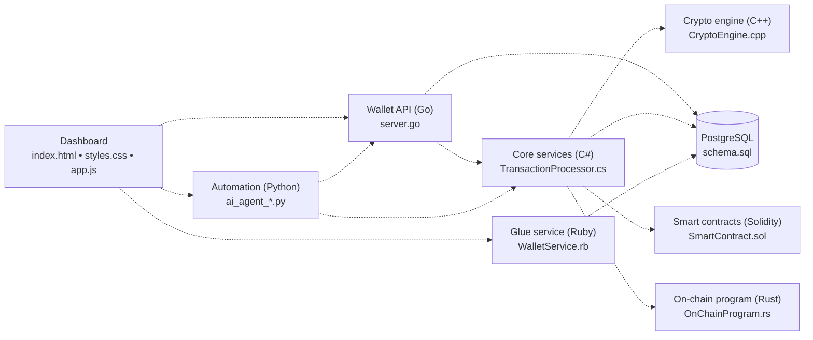

<div align="center">

# ⚡ MAGNUM OPUS

### One repository. Eight languages. The entire Web3 stack.

*A multi‑language, AI‑assisted showcase of how a crypto platform fits together, from the browser dashboard down to the on‑chain program.*

[](https://github.com/LinkHAckerman/MasterProject/blob/main/LICENSE)
[](#-project-status-read-this-first)
[](SECURITY.md)
[](#-the-autonomous-development-pipeline)
[](https://github.com/LinkHAckerman/MasterProject/actions)
[](https://github.com/LinkHAckerman/LinkHAckerman/blob/main/header.svg)


**[🌐 Live dashboard demo](https://linkhackerman.github.io/MasterProject/index.html) · [🤝 Contribute](CONTRIBUTING.md) · [🔐 Security](SECURITY.md)**

</div>

---

## 📚 Table of Contents

1. [Overview](#-overview)
2. [Project status: read this first](#-project-status-read-this-first)
3. [Architecture](#-architecture)
4. [Component map](#-component-map)
5. [Quick start](#-quick-start)
6. [Repository layout](#-repository-layout)
7. [Project documents](#-project-documents)
8. [Known limitations](#-known-limitations)
9. [Roadmap](#-roadmap)
10. [Contributing](#-contributing)
11. [License](#-license)

---

## 🌐 Overview

**Magnum Opus** is an ambitious, ever‑evolving attempt to put every layer of a modern crypto platform into a single repository, each layer written in the language best suited to the job:

| Layer | Language | Role |
|------|----------|------|
| Dashboard | **HTML / CSS / JavaScript** | Dark‑theme trading and portfolio UI |
| Core services | **C# (.NET)** | Transaction validation, block production, receipts |
| Performance engine | **C++** | Hashing, Merkle proofs, order‑matching, AMM math |
| Smart contracts | **Solidity** | ERC‑20 token, staking vault, constant‑product DEX |
| Microservice | **Go** | Wallet and transfer REST API |
| Data layer | **SQL (PostgreSQL)** | Users, wallets, assets, NFTs, DeFi history, audit logs |
| On‑chain program | **Rust (Anchor / Solana)** | Vault program with deposits, withdrawals and events |
| Glue layer | **Ruby** | Exchange‑rate helpers, wallet balance aggregation |
| Automation & validation | **Python** | CI agents, file validation scripts |

The goal is to demonstrate **breadth, systems thinking and craft across ecosystems**. The code is **demo‑grade**, **not audited**, and **must never be used with real funds**.

---

## ⚠️ Project status: read this first

Magnum Opus is a **showcase and learning project, not a production product**. Please keep the following in mind:

- **Demo‑grade code.** Components are real, readable implementations but most are **stand‑alone modules** that are **not yet wired together** into a running end‑to‑end system.
- **Not audited.** The contracts, on‑chain program, wallet logic and cryptographic routines have had **no independent security review**. **Never use this code with real assets.** See [SECURITY.md](SECURITY.md) and [TERMS.md](TERMS.md).
- **AI‑assisted and changing daily.** Content is generated and revised by automated agents and checked only by basic automated validation. Expect rough edges.
- **No financial advice.** Nothing here is investment advice or an offer of any asset. All market data in the dashboard is simulated.

---

## 🏗️ Architecture



The C++ engine exposes a C‑linkage API (`extern "C"`) so the C# and Go layers can call into it later through P/Invoke or cgo.

---

## 📦 Component map

| File | Language | What is in it today | Status |
|------|----------|---------------------|--------|
| `index.html` | HTML | Dark "glass" dashboard: portfolio metrics, charts, order book, wallet UI | ✅ Implemented |
| `styles.css` | CSS | Theme, layout, glass‑morphism effects | ✅ Implemented |
| `app.js` | JavaScript | UI state management, simulated market data, event handling | ✅ Implemented |
| `TransactionProcessor.cs` | C# | Core transaction validation, mock block production, JSON‑API helpers | ✅ Implemented |
| `CryptoEngine.cpp` | C++ | High‑performance hashing, Merkle tree utilities, AMM math library | ✅ Implemented |
| `SmartContract.sol` | Solidity | ERC‑20 token, staking vault, constant‑product DEX skeleton | ✅ Implemented |
| `server.go` | Go | Minimal REST API for wallet creation, balance queries, transaction relay | ✅ Implemented |
| `WalletService.rb` | Ruby | Exchange‑rate fetcher, wallet balance aggregation, simple caching layer | ✅ Implemented |
| `schema.sql` | SQL | PostgreSQL schema for users, wallets, assets, transaction history, NFT metadata | ✅ Implemented |
| `OnChainProgram.rs` | Rust | Anchor‑based Solana program: vault initialization, deposit/withdraw logic | ✅ Implemented |
| `agent_common.py`, `ai_agent_*.py` | Python | Automation agents that run daily, lint files, generate PRs | ✅ Implemented |
| `.github/workflows/daily_agent.yml` | YAML | GitHub Actions workflow that triggers the daily AI agent | ✅ Implemented |
| `validate_files.py` | Python | Helper script used by CI to ensure required files exist and are well‑formed | ✅ Implemented |
| `scaffold/test.txt` | Text | Placeholder used by CI to verify repository layout | ✅ Implemented |

---

## 🚀 Quick start

> **Note**: This guide assumes you have a recent version of **Node.js**, **.NET 7 SDK**, **C++ build tools (gcc/clang or MSVC)**, **Go 1.22+**, **Ruby 3.2+**, and a running **PostgreSQL** instance.

1. **Clone the repository**
   ```bash
   git clone https://github.com/LinkHAckerman/MasterProject.git
   cd MasterProject
   ```

2. **Set up the database**
   ```bash
   createdb magnum_opus
   psql -d magnum_opus -f schema.sql
   ```
   The schema creates tables for users, wallets, assets, transactions and NFT metadata.

3. **Run the front‑end** (no build step – static files)
   ```bash
   # You can serve the files with any static server, e.g. Python's http.server
   python -m http.server 8080
   # Then open http://localhost:8080/index.html in a browser
   ```

4. **Start the C# core service**
   ```bash
   dotnet run --project TransactionProcessor.csproj
   # The service listens on http://localhost:5000 by default
   ```

5. **Build the C++ crypto engine** (produces a shared library `libcryptoengine.so` or `cryptoengine.dll`)
   ```bash
   mkdir -p build && cd build
   cmake ..
   make   # or `cmake --build .` on Windows
   cd ..
   ```
   The library will be loaded by the C# service in a future integration step.

6. **Run the Go wallet API**
   ```bash
   go run server.go
   # API available at http://localhost:8081
   ```

7. **Start the Ruby glue service**
   ```bash
   ruby WalletService.rb
   # Provides exchange‑rate endpoint on http://localhost:8082
   ```

8. **(Optional) Deploy the Solidity contracts**
   ```bash
   # Requires `forge` or `hardhat`. Example with forge:
   forge build
   forge create --rpc-url https://goerli.infura.io/v3/<PROJECT_ID> src/SmartContract.sol:MagnumOpusDeFiEngine
   ```
   The contracts are **not deployed** in the demo environment.

9. **(Optional) Deploy the Solana program**
   ```bash
   anchor build
   anchor deploy
   ```
   Again, this is illustrative only.

You now have all components running locally. The dashboard UI fetches mock data from the C# and Go services, while the Ruby service supplies fiat‑to‑crypto rates.

---

## 📂 Repository layout

```
MasterProject/
├─ .github/workflows/daily_agent.yml
├─ CLA.md
├─ CODE_OF_CONDUCT.md
├─ CONTRIBUTING.md
├─ LICENSE
├─ README.md
├─ SECURITY.md
├─ TERMS.md
├─ SmartContract.sol
├─ TransactionProcessor.cs
├─ CryptoEngine.cpp
├─ OnChainProgram.rs
├─ server.go
├─ WalletService.rb
├─ schema.sql
├─ app.js
├─ index.html
├─ styles.css
├─ scaffold/
│  └─ test.txt
├─ agent_common.py
├─ ai_agent.py
├─ ai_agent_cloudflare.py
├─ ai_agent_github_models.py
├─ ai_agent_groq.py
├─ ai_agent_mistral.py
├─ ai_agent_openrouter.py
└─ validate_files.py
```

---

## 📄 Project documents

- **[LICENSE](LICENSE)** – MIT License
- **[CONTRIBUTING.md](CONTRIBUTING.md)** – Guidelines for contributing
- **[CLA.md](CLA.md)** – Contributor License Agreement
- **[CODE_OF_CONDUCT.md](CODE_OF_CONDUCT.md)** – Community standards
- **[SECURITY.md](SECURITY.md)** – Security policy and vulnerability reporting
- **[TERMS.md](TERMS.md)** – Terms of use and disclaimer

---

## ⚙️ Known limitations

- Components are **isolated**; there is no end‑to‑end integration yet.
- Cryptographic primitives in `CryptoEngine.cpp` are **educational** and not vetted for production.
- Smart contracts and the Solana program have **no test suite** and have not been audited.
- The CI workflow only runs a daily AI agent that validates file presence; no unit or integration tests are executed.
- Documentation is manually maintained and may drift from code.

---

## 🛣️ Roadmap (planned work)

- **Integration layer**: Wire the Go wallet API, C# core, and C++ engine together via P/Invoke / cgo.
- **Real‑time data feeds**: Connect the dashboard to live market data APIs.
- **Automated testing**: Add unit tests for each language component and CI pipelines for linting and security scanning.
- **Docker / Helm support**: Provide containerised deployment for the full stack.
- **Full end‑to‑end demo**: Deploy contracts to a testnet, run the Solana program, and demonstrate a complete user flow.
- **Security audit**: Engage external auditors for the Solidity and Rust code.

---

## 🤝 Contributing

Contributions are welcome! Please read the [CONTRIBUTING.md](CONTRIBUTING.md) guide, sign the [CLA](CLA.md), and follow the [CODE_OF_CONDUCT.md](CODE_OF_CONDUCT.md). All pull requests are reviewed by the maintainers and the daily AI agent runs validation checks before merging.

---

## 📄 License

This project is licensed under the **MIT License** – see the [LICENSE](LICENSE) file for details.
