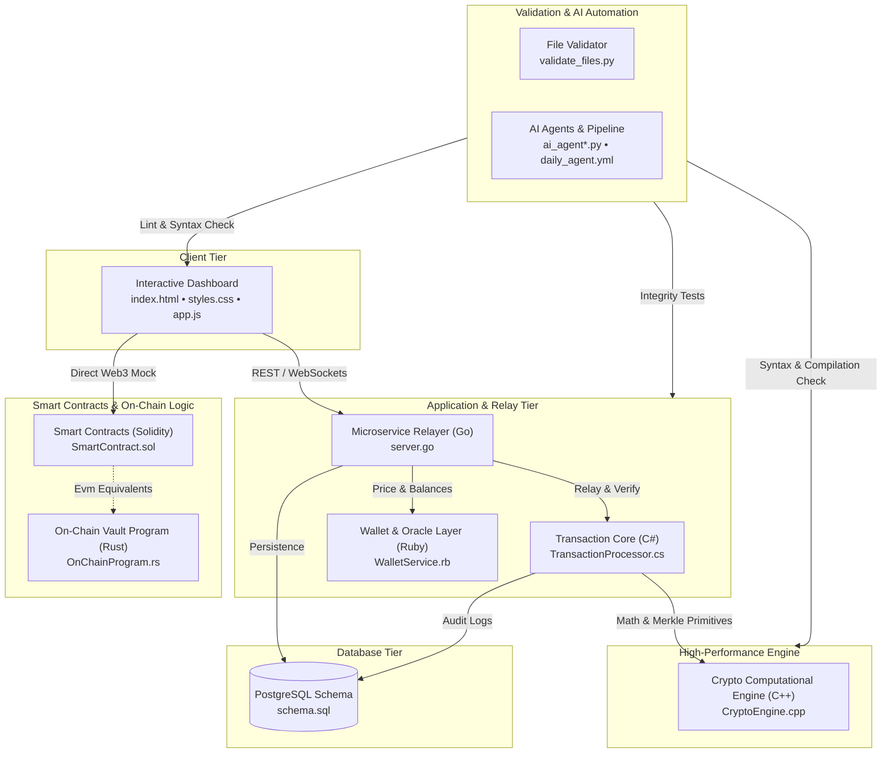

<div align="center">

# ⚡ MAGNUM OPUS

### One repository. Eight languages. The entire Web3 stack.

*A multi-language, AI-assisted architectural showcase demonstrating how modern Web3, DeFi, and blockchain systems integrate across frontend, backend, engine, contract, and data layers.*

[](LICENSE)
[](#-project-status-read-this-first)
[](SECURITY.md)
[](#-automation-and-ai-agent-pipeline)
[](https://github.com/LinkHAckerman/MasterProject/actions)
[](https://github.com/LinkHAckerman/LinkHAckerman/blob/main/header.svg)


**[🌐 Live Dashboard Demo](https://linkhackerman.github.io/MasterProject/index.html) · [🤝 Contribute](CONTRIBUTING.md) · [🔒 Security](SECURITY.md)**

</div>

---

## 📚 Table of Contents

1. [Overview](#-overview)
2. [Project Status: Read This First](#-project-status-read-this-first)
3. [Architecture](#-architecture)
4. [Component Map](#-component-map)
5. [Quick Start](#-quick-start)
6. [Automation and AI Agent Pipeline](#-automation-and-ai-agent-pipeline)
7. [Repository Layout](#-repository-layout)
8. [Project Documents](#-project-documents)
9. [Known Limitations](#-known-limitations)
10. [Roadmap](#-roadmap)
11. [Contributing](#-contributing)
12. [License](#-license)

---

## 🌐 Overview

**Magnum Opus** is an architectural reference implementation bringing together each tier of a Web3 platform into a single repository. Each component is authored in an idiomatic language suited for its specific workload and performance profile:

| Layer | Language | Source File | Role |
|---|---|---|---|
| **Frontend Dashboard** | HTML5 / CSS3 / JavaScript | `index.html`, `styles.css`, `app.js` | Dark-theme Web3 trading, staking, portfolio, and swap interface |
| **Core Ledger & Processing** | C# (.NET Core) | `TransactionProcessor.cs` | Transaction lifecycle validation, Merkle block generation, cryptographic receipts |
| **High-Performance Engine** | C++ (C++20) | `CryptoEngine.cpp` | SHA-256 computation, Merkle tree verification, AMM math, order-book matching |
| **Smart Contracts** | Solidity (0.8.24) | `SmartContract.sol` | Multi-token vault, AMM swap liquidity pools, yield staking, NFT badge logic |
| **Microservice Relayer** | Go (Golang) | `server.go` | Lightweight concurrent transaction relayer, wallet proxy, and WebSocket broadcaster |
| **Data Persistence** | PostgreSQL / SQL | `schema.sql` | Relational ledger schema for accounts, transactions, order books, and NFT metadata |
| **On-Chain Program** | Rust (Solana / Anchor) | `OnChainProgram.rs` | Memory-safe on-chain vault program with account state validation and instruction routing |
| **Glue & Oracle Layer** | Ruby | `WalletService.rb` | Balance aggregation, rate caching, mock oracles, and cross-tier transaction utilities |
| **Validation & Automation** | Python 3 | `validate_files.py`, `ai_agent*.py` | Multi-model agent pipeline and syntax validation test suite |

---

## ⚠️ Project Status: Read This First

Magnum Opus is an **educational and architectural demonstration**, not a commercial or production deployment:

- **Educational Reference:** Components are functional, source-complete implementations designed to illustrate multi-language blockchain patterns. Most components operate as standalone units or mock integration harnesses.
- **Not Audited:** The Solidity smart contracts, Rust on-chain program, C++ cryptographic primitives, and wallet relayers have **not undergone formal third-party audits**. **Do not deploy with real digital assets or private keys.** Consult [SECURITY.md](SECURITY.md) and [TERMS.md](TERMS.md).
- **AI-Assisted Development:** Files in this repository are collaboratively developed and refined with AI agent workflows. Continuous syntax and integrity validation is performed via `validate_files.py`.
- **Simulated Market Environment:** Market rates, liquidity metrics, and transaction receipts rendered in the web dashboard are simulated demonstrations.

---

## 🏗️ Architecture



---

## 🧩 Component Map

### 1. Frontend Web Client (`index.html`, `styles.css`, `app.js`)
- Modern dark-theme Web3 dashboard showcasing token balances, live charting, transaction activity, and swap calculators.
- Glassmorphism design system built with vanilla CSS custom properties.
- Reactive JavaScript event handling with zero external runtime bundle dependencies.

### 2. Transaction Processor (`TransactionProcessor.cs`)
- Concurrent ledger state management utilizing .NET thread-safe collections.
- Merkle root calculation, block construction, and cryptographic signature verification.
- Comprehensive JSON serialization for network payloads and transaction logging.

### 3. High-Performance Crypto Engine (`CryptoEngine.cpp`)
- Standard C++20 implementation of SHA-256 and cryptographic hashing.
- Constant-product AMM pricing calculations (`x * y = k`) with slippage protection.
- Merkle tree verification engine and in-memory order-book matcher.

### 4. Smart Contracts (`SmartContract.sol`)
- Solidity 0.8.24 contract suite featuring ERC-20 token mechanics, AMM swap pool, staking rewards distribution, and governance structures.
- Reentrancy guards, custom error types, and safe transfer logic.

### 5. Microservice Relayer (`server.go`)
- Concurrent HTTP and WebSocket server for transaction broadcasting and wallet synchronization.
- In-memory rate limiting and health monitoring endpoints.

### 6. Relational Database Schema (`schema.sql`)
- Normalized PostgreSQL schema modeling users, multi-chain wallets, token balances, transaction receipts, and order histories.
- Includes indexes, constraints, and audit timestamp triggers.

### 7. On-Chain Program (`OnChainProgram.rs`)
- Rust-based on-chain vault program compatible with the Solana / Anchor programming model.
- Secure deposit, withdrawal, and reward accrual instructions with strict account validation.

### 8. Wallet & Oracle Service (`WalletService.rb`)
- Object-oriented Ruby service for fetching currency exchange rates, computing portfolio balances, and generating cryptographic hashes.
- High-precision monetary arithmetic using `BigDecimal`.

### 9. Validation and AI Automation (`validate_files.py`, `agent_common.py`, `ai_agent*.py`)
- Multi-provider AI agents supporting automated continuous codebase maintenance.
- Python validation script running multi-language static syntax checks across all repository files.

---

## 🚀 Quick Start

### Clone the Repository

```bash
git clone https://github.com/LinkHAckerman/MasterProject.git
cd MasterProject
```

### Run the Local Validation Suite

Ensure Python 3 is installed, then execute the syntax and sanity test suite:

```bash
python3 validate_files.py
```

### Launch the Web Dashboard

The dashboard has no build step or node package dependencies. Open `index.html` directly in your browser or run a simple local web server:

```bash
# Python 3 built-in HTTP server
python3 -m http.server 8080
```
Navigate to `http://localhost:8080` in your web browser.

### Compile & Run Individual Components

#### C++ Crypto Engine
```bash
g++ -std=c++20 -O3 CryptoEngine.cpp -o crypto_engine
./crypto_engine
```

#### Go Relayer Microservice
```bash
go run server.go
```

#### C# Transaction Processor
```bash
dotnet run TransactionProcessor.cs
# Or compile via Roslyn:
csc /out:TransactionProcessor.exe TransactionProcessor.cs
```

#### Ruby Wallet Service
```bash
ruby WalletService.rb
```

#### PostgreSQL Schema Verification
```bash
psql -U postgres -d postgres -f schema.sql
```

---

## 🤖 Automation and AI Agent Pipeline

This repository includes automated maintenance scripts designed to interface with multiple AI inference backends:

- `agent_common.py`: Shared utilities, prompt generation, git operations, and response parsers.
- `ai_agent.py`: Default agent runner for automated file review and incremental refinement.
- `ai_agent_cloudflare.py`: Cloudflare Workers AI integration runner.
- `ai_agent_github_models.py`: GitHub Models integration runner.
- `ai_agent_groq.py`: Groq Cloud LLM integration runner.
- `ai_agent_mistral.py`: Mistral AI API integration runner.
- `ai_agent_openrouter.py`: OpenRouter unified endpoint integration runner.
- `.github/workflows/daily_agent.yml`: GitHub Actions scheduled workflow running automated codebase review and validation.

---

## 📂 Repository Layout

```text
MasterProject/
├── .github/
│   └── workflows/
│       └── daily_agent.yml       # Automated GitHub Actions daily pipeline
├── scaffold/
│   └── test.txt                  # Test harness scaffolding placeholder
├── agent_common.py               # Shared AI agent helper functions
├── ai_agent.py                   # Primary automated agent entry point
├── ai_agent_cloudflare.py        # Cloudflare Workers AI integration
├── ai_agent_github_models.py     # GitHub Models integration
├── ai_agent_groq.py              # Groq API integration
├── ai_agent_mistral.py           # Mistral AI API integration
├── ai_agent_openrouter.py        # OpenRouter API integration
├── app.js                        # Frontend dashboard client logic
├── CLA.md                        # Contributor License Agreement
├── CODE_OF_CONDUCT.md            # Contributor Covenant Code of Conduct
├── CONTRIBUTING.md                # Contribution guidelines and practices
├── CryptoEngine.cpp              # High-performance C++ crypto & math engine
├── index.html                    # Frontend dashboard markup
├── LICENSE                       # MIT Open Source License
├── OnChainProgram.rs             # Solana/Anchor on-chain Rust vault program
├── README.md                     # Repository documentation
├── schema.sql                    # PostgreSQL relational database schema
├── SECURITY.md                   # Security reporting and vulnerability policy
├── server.go                     # Go microservice transaction relayer
├── SmartContract.sol             # Solidity EVM smart contract suite
├── styles.css                    # Frontend design system stylesheets
├── TERMS.md                      # Terms of use and legal disclaimers
├── TransactionProcessor.cs       # C# transaction processing engine
├── validate_files.py             # Multi-language syntax and file validator
└── WalletService.rb              # Ruby wallet and oracle aggregation service
```

---

## 📄 Project Documents

- [LICENSE](LICENSE) — Official MIT License.
- [CONTRIBUTING.md](CONTRIBUTING.md) — Guidelines for submitting code, issues, and AI-assisted PRs.
- [CLA.md](CLA.md) — Contributor License Agreement.
- [SECURITY.md](SECURITY.md) — Security policy and vulnerability disclosure procedures.
- [TERMS.md](TERMS.md) — Disclaimer of warranties and terms of use.
- [CODE_OF_CONDUCT.md](CODE_OF_CONDUCT.md) — Contributor Covenant Code of Conduct.

---

## ⚠️ Known Limitations

- **Mock Network Integrations:** The repository does not deploy real nodes or broadcast to live mainnets; networking harnesses simulate responses.
- **Stateless Execution:** Components currently run as decoupled demonstrations rather than a unified single-command runtime.
- **Audit Status:** Smart contracts and cryptographic functions are designed for demonstration purposes only and must **not** be used in production.

---

## 🗺️ Roadmap

*(Planned work items for future milestones)*

- [ ] **Unified Inter-Process Communication:** Standardize JSON-RPC interfaces between `server.go`, `TransactionProcessor.cs`, and `CryptoEngine.cpp`.
- [ ] **Cross-Language Test Harness:** Expand `validate_files.py` to invoke native compiler test suites when compilers are detected in the environment.
- [ ] **Local Docker Orchestration:** Add containerized development recipes once all components reach stable cross-service protocol parity.
- [ ] **Extended Rust Anchor Client:** Add an interactive client script interacting with the Solana program IDL.

---

## 🤝 Contributing

Contributions are welcome! Please read [CONTRIBUTING.md](CONTRIBUTING.md) and review the [CODE_OF_CONDUCT.md](CODE_OF_CONDUCT.md) prior to submitting pull requests. All contributions are subject to our [Contributor License Agreement](CLA.md).

---

## 📜 License

This project is licensed under the terms of the [MIT License](LICENSE).
Copyright © FCX Trading Ltd. and MasterProject Contributors.