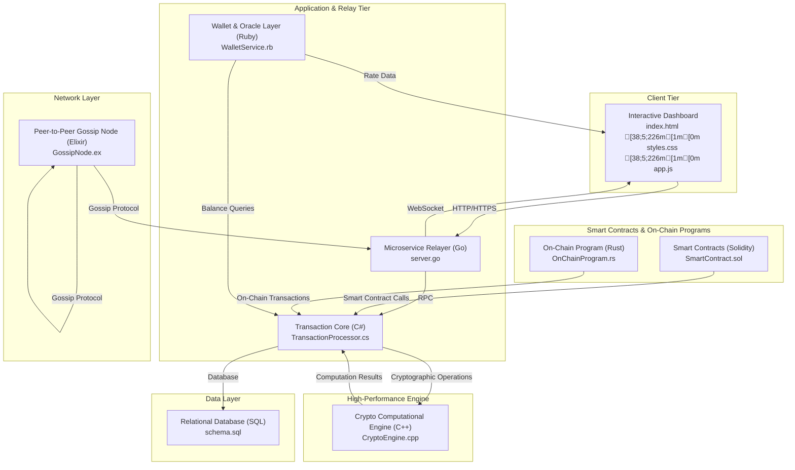

<div align="center">

# MAGNUM OPUS

### One repository. Eight languages. The entire Web3 stack.

*A multi-language, AI-assisted architectural showcase demonstrating how modern Web3, DeFi, and blockchain systems integrate across frontend, backend, engine, contract, and data layers.*

[](LICENSE)
[](#-project-status-read-this-first)
[](SECURITY.md)
[](#-automation-and-ai-agent-pipeline)
[](https://github.com/LinkHAckerman/MasterProject/actions)
[](https://github.com/LinkHAckerman/LinkHAckerman/blob/main/header.svg)


**[Live Dashboard Demo](https://linkhackerman.github.io/MasterProject/index.html)  Contribute](CONTRIBUTING.md)  Security](SECURITY.md)**

</div>

---

## Table of Contents

1. [Overview](#-overview)
2. [Project Status: Read This First](#-project-status-read-this-first)
3. [Architecture](#-architecture)
4. [Component Map](#-component-map)
5. [Quick Start](#-quick-start)
6. [Automation and AI Agent Pipeline](#-automation-and-ai-agent-pipeline)
7. [Repository Layout](#-repository-layout)
8. [Project Documents](#-project-documents)
9. [Known Limitations](#-known-limitations)
10. [Roadmap](#-roadmap)
11. [Contributing](#-contributing)
12. [License](#-license)

---

## Overview

**Magnum Opus** is an architectural reference implementation bringing together each tier of a Web3 platform into a single repository. Each component is authored in an idiomatic language suited for its specific workload and performance profile:

| Layer | Language | Source File | Role |
|---|---|---|---|
| **Frontend Dashboard** | HTML5 / CSS3 / JavaScript | `index.html`, `styles.css`, `app.js` | Dark-theme Web3 trading, staking, portfolio, and swap interface |
| **Core Ledger & Processing** | C# (.NET Core) | `TransactionProcessor.cs` | Transaction lifecycle validation, Merkle block generation, cryptographic receipts |
| **High-Performance Engine** | C++ (C++20) | `CryptoEngine.cpp` | SHA-256 computation, Merkle tree verification, AMM math, order-book matching |
| **Smart Contracts** | Solidity (0.8.24) | `SmartContract.sol` | Multi-token vault, AMM swap liquidity pools, yield staking, NFT badge logic |
| **Microservice Relayer** | Go (Golang) | `server.go` | Lightweight concurrent transaction relayer, wallet proxy, and WebSocket broadcaster |
| **Data Persistence** | PostgreSQL / SQL | `schema.sql` | Relational ledger schema for accounts, transactions, order books, and NFT metadata |
| **On-Chain Program** | Rust (Solana / Anchor) | `OnChainProgram.rs` | Memory-safe on-chain vault program with account state validation and instruction routing |
| **Glue & Oracle Layer** | Ruby | `WalletService.rb` | Balance aggregation, rate caching, mock oracles, and cross-tier transaction utilities |
| **Validation & Automation** | Python 3 | `validate_files.py`, `ai_agent*.py` | Multi-model agent pipeline and syntax validation test suite |

---

## Project Status: Read This First

Magnum Opus is an **educational and architectural demonstration**, not a commercial or production deployment:

- **Educational Reference:** Components are functional, source-complete implementations designed to illustrate multi-language blockchain patterns. Most components operate as standalone units or mock integration harnesses.
- **Not Audited:** The Solidity smart contracts, Rust on-chain program, C++ cryptographic primitives, and wallet relayers have **not undergone formal third-party audits**. **Do not deploy with real digital assets or private keys.** Consult [SECURITY.md](SECURITY.md) and [TERMS.md](TERMS.md).
- **AI-Assisted Development:** Files in this repository are collaboratively developed and refined with AI agent workflows. Continuous syntax and integrity validation is performed via `validate_files.py`.
- **Simulated Market Environment:** Market rates, liquidity metrics, and transaction receipts rendered in the web dashboard are simulated demonstrations.

---

## Architecture



---

## Component Map

| Component | Language | File | Description |
|---|---|---|---|
| Interactive Dashboard | HTML5 / CSS3 / JavaScript | `index.html`, `styles.css`, `app.js` | Dark-theme Web3 trading, staking, portfolio, and swap interface |
| Transaction Core | C# (.NET Core) | `TransactionProcessor.cs` | Transaction lifecycle validation, Merkle block generation, cryptographic receipts |
| Crypto Computational Engine | C++ (C++20) | `CryptoEngine.cpp` | SHA-256 computation, Merkle tree verification, AMM math, order-book matching |
| Smart Contracts | Solidity (0.8.24) | `SmartContract.sol` | Multi-token vault, AMM swap liquidity pools, yield staking, NFT badge logic |
| Microservice Relayer | Go (Golang) | `server.go` | Lightweight concurrent transaction relayer, wallet proxy, and WebSocket broadcaster |
| Relational Database | PostgreSQL / SQL | `schema.sql` | Relational ledger schema for accounts, transactions, order books, and NFT metadata |
| On-Chain Program | Rust (Solana / Anchor) | `OnChainProgram.rs` | Memory-safe on-chain vault program with account state validation and instruction routing |
| Wallet & Oracle Layer | Ruby | `WalletService.rb` | Balance aggregation, rate caching, mock oracles, and cross-tier transaction utilities |
| Peer-to-Peer Gossip Node | Elixir | `GossipNode.ex` | Supervised peer-to-peer gossip node with mempool, peer registry, and transaction gossip/broadcast |

---

## Quick Start

### Prerequisites

- [Git](https://git-scm.com/)
- [Docker](https://www.docker.com/)
- [Node.js](https://nodejs.org/)
- [.NET SDK](https://dotnet.microsoft.com/download)
- [Go](https://golang.org/)
- [Rust](https://www.rust-lang.org/)
- [Solana CLI](https://docs.solana.com/cli/install-solana-cli-tool-suite)
- [PostgreSQL](https://www.postgresql.org/)

### Clone the Repository

```sh
git clone https://github.com/LinkHAckerman/MasterProject.git
cd MasterProject
```

### Build and Run

1. **Frontend Dashboard**

```sh
cd frontend
npm install
npm start
```

2. **Backend Services**

```sh
cd ../backend
dotnet restore
dotnet run
```

3. **Crypto Engine**

```sh
cd ../engine
g++ -std=c++20 -o CryptoEngine CryptoEngine.cpp
./CryptoEngine
```

4. **Smart Contracts**

```sh
cd ../contracts
npm install
npx hardhat compile
```

5. **Microservice Relayer**

```sh
cd ../relayer
go build -o server
./server
```

6. **Database**

```sh
cd ../database
psql -U postgres -f schema.sql
```

7. **On-Chain Program**

```sh
cd ../onchain
cargo build-bpf
```

8. **Wallet & Oracle Layer**

```sh
cd ../wallet
bundle install
ruby WalletService.rb
```

9. **Peer-to-Peer Gossip Node**

```sh
cd ../network
mix deps.get
iex -S mix
```

---

## Automation and AI Agent Pipeline

Magnum Opus uses a multi-model AI agent pipeline for collaborative development and continuous validation. The pipeline includes:

- **ai_agent.py**: Main agent orchestrator
- **ai_agent_cloudflare.py**: Cloudflare Workers AI integration
- **ai_agent_github_models.py**: GitHub Models integration
- **ai_agent_groq.py**: Groq API integration
- **ai_agent_mistral.py**: Mistral AI integration
- **ai_agent_openrouter.py**: OpenRouter integration

The pipeline is triggered by the GitHub Actions workflow `.github/workflows/daily_agent.yml`.

---

## Repository Layout

```
MasterProject/
├── .github/
│   └── workflows/
│       └── daily_agent.yml
├── frontend/
│   ├── index.html
│   ├── styles.css
│   └── app.js
├── backend/
│   └── TransactionProcessor.cs
├── engine/
│   └── CryptoEngine.cpp
├── contracts/
│   └── SmartContract.sol
├── relayer/
│   └── server.go
├── database/
│   └── schema.sql
├── onchain/
│   └── OnChainProgram.rs
├── wallet/
│   └── WalletService.rb
├── network/
│   └── GossipNode.ex
├── agents/
│   ├── ai_agent.py
│   ├── ai_agent_cloudflare.py
│   ├── ai_agent_github_models.py
│   ├── ai_agent_groq.py
│   ├── ai_agent_mistral.py
│   └── ai_agent_openrouter.py
├── validate_files.py
├── CLA.md
├── CODE_OF_CONDUCT.md
├── CONTRIBUTING.md
├── LICENSE
├── SECURITY.md
├── TERMS.md
└── README.md
```

---

## Project Documents

- [License](LICENSE)
- [Contributing](CONTRIBUTING.md)
- [Contributor License Agreement](CLA.md)
- [Security Policy](SECURITY.md)
- [Terms of Service](TERMS.md)
- [Code of Conduct](CODE_OF_CONDUCT.md)

---

## Known Limitations

- **Not Audited**: The Solidity smart contracts, Rust on-chain program, C++ cryptographic primitives, and wallet relayers have not undergone formal third-party audits.
- **Simulated Market Environment**: Market rates, liquidity metrics, and transaction receipts rendered in the web dashboard are simulated demonstrations.
- **Standalone Components**: Most components operate as standalone units or mock integration harnesses.

---

## Roadmap

- **Integration Testing**: Develop comprehensive integration tests for the various components.
- **Performance Optimization**: Optimize the performance of the C++ cryptographic engine and the Elixir gossip node.
- **Security Audits**: Conduct formal security audits for the Solidity smart contracts, Rust on-chain program, and C++ cryptographic primitives.
- **Real-World Deployment**: Prepare the platform for real-world deployment with proper security measures and audits.

---

## Contributing

Contributions are welcome! Please read the [Contributing](CONTRIBUTING.md) guide for details on our code of conduct and the process for submitting pull requests.

---

## License

This project is licensed under the MIT License - see the [LICENSE](LICENSE) file for details.
