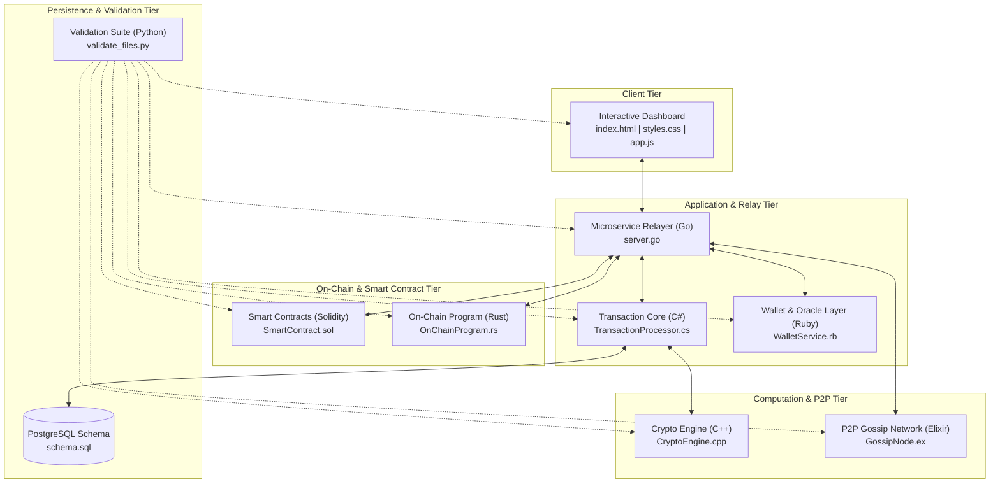

<div align="center">

# MAGNUM OPUS

### One repository. Nine languages. The entire Web3 stack.

*A multi-language, AI-assisted architectural showcase demonstrating how modern Web3, DeFi, and blockchain systems integrate across frontend, backend, engine, contract, data, and peer-to-peer gossip layers.*

[](LICENSE)
[](#project-status-read-this-first)
[](SECURITY.md)
[](.github/workflows/daily_agent.yml)

**[Live Dashboard Demo](https://linkhackerman.github.io/MasterProject/index.html) | [Contribute](CONTRIBUTING.md) | [Security](SECURITY.md)**

</div>

---

## Table of Contents

1. [Overview](#overview)
2. [Project Status: Read This First](#project-status-read-this-first)
3. [Architecture & Component Map](#architecture--component-map)
4. [Repository Layout](#repository-layout)
5. [Quick Start & Validation](#quick-start--validation)
6. [Testing](#testing)
7. [Automation and AI Agent Pipeline](#automation-and-ai-agent-pipeline)
8. [Project Documents](#project-documents)
9. [Known Limitations](#known-limitations)
10. [Roadmap](#roadmap)
11. [Contributing](#contributing)
12. [License](#license)

---

## Overview

**Magnum Opus** is an architectural reference implementation bringing together each tier of a Web3 platform into a single repository (`LinkHAckerman/MasterProject`). Each component is authored in an idiomatic language suited for its specific workload and performance profile:

| Layer | Language | Source File | Role |
|---|---|---|---|
| **Frontend Dashboard** | HTML5 / CSS3 / JavaScript | `index.html`, `styles.css`, `app.js` | Dark-theme Web3 trading, staking, portfolio, and swap interface |
| **Core Ledger & Processing** | C# (.NET) | `TransactionProcessor.cs` | Transaction lifecycle validation, Merkle block generation, cryptographic receipts |
| **High-Performance Engine** | C++ (C++20) | `CryptoEngine.cpp` | SHA-256 computation, Merkle tree verification, AMM math, order-book matching |
| **Smart Contracts** | Solidity (0.8.20+) | `SmartContract.sol` | Multi-token vault, AMM swap liquidity pools, yield staking, NFT badge logic |
| **Microservice Relayer** | Go (Golang) | `server.go` | Lightweight concurrent transaction relayer, wallet proxy, and WebSocket broadcaster |
| **Data Persistence** | PostgreSQL / SQL | `schema.sql` | Relational ledger schema for accounts, transactions, order books, and NFT metadata |
| **On-Chain Program** | Rust (Solana / Anchor) | `OnChainProgram.rs` | Memory-safe on-chain vault program with account state validation and instruction routing |
| **Glue & Oracle Layer** | Ruby | `WalletService.rb` | Balance aggregation, rate caching, mock oracles, and cross-tier transaction utilities |
| **P2P Gossip Network** | Elixir (OTP) | `GossipNode.ex` | Supervised peer-to-peer gossip node, OTP GenServer mempool, peer discovery and registry |
| **Validation & Automation** | Python 3 | `validate_files.py`, `agent_common.py`, `ai_agent*.py` | Multi-model agent automation pipeline and syntax validation test suite |

---

## Project Status: Read This First

Magnum Opus is an **educational and architectural demonstration**, not a commercial or production deployment:

- **Educational Reference:** Components are functional, source-complete implementations designed to illustrate multi-language blockchain patterns. Most components operate as standalone units or mock integration harnesses.
- **Not Audited:** The Solidity smart contracts, Rust on-chain program, C++ cryptographic primitives, Go microservice, Elixir gossip node, and wallet relayers have **not undergone formal third-party audits**. **Do not deploy with real digital assets or private keys.** Consult [SECURITY.md](SECURITY.md) and [TERMS.md](TERMS.md).
- **AI-Assisted Development:** Files in this repository are collaboratively developed and refined with AI agent workflows (`ai_agent*.py`). Continuous syntax and integrity validation is performed via `validate_files.py`.
- **Simulated Market Environment:** Market rates, liquidity metrics, and transaction receipts rendered in the web dashboard are simulated demonstrations.

---

## Architecture & Component Map



### Detailed Component Roles

- **`index.html` / `styles.css` / `app.js`**: Web3 dark-theme frontend interface for monitoring wallet balances, transaction logs, liquidity pools, and executing simulated crypto swaps.
- **`CryptoEngine.cpp`**: C++20 computational engine executing high-throughput SHA-256 block hashing, Merkle tree construction, and order matching logic.
- **`TransactionProcessor.cs`**: C# .NET core ledger service handling transaction channels, batch validation, lock-free concurrency, and block generation.
- **`SmartContract.sol`**: Solidity smart contract suite implementing ERC20 tokens (`MagnumOpusToken`) and ERC721 NFTs (`MagnumOpusNFT`) with role-based controls, staking, and vault features.
- **`server.go`**: Go microservice providing HTTP and WebSocket endpoints for wallet transaction relaying, rate-limiting, and signature verification.
- **`schema.sql`**: Comprehensive PostgreSQL relational schema defining tables, indexes, triggers, and foreign keys for transactions, accounts, and market depth.
- **`OnChainProgram.rs`**: Solana Anchor Rust program managing on-chain vault accounts, authority signatures, and balance transfers.
- **`WalletService.rb`**: Ruby utility service providing currency conversions, oracle rate aggregation, and mock transaction signing routines.
- **`GossipNode.ex`**: Elixir OTP application featuring a supervised P2P gossip server, GenServer mempool, peer registry, and transaction broadcast mechanisms.
- **`validate_files.py`**: Python script that validates syntax across all repository source files (JS, C++, C#, Solidity, Go, SQL, Rust, Ruby, Elixir).
- **`agent_common.py` & `ai_agent*.py`**: Shared utilities and provider-specific autonomous agents managing automated daily file enhancements and code generation across LLM providers.

---

## Repository Layout

```text
MasterProject/
├── .github/
│   └── workflows/
│       └── daily_agent.yml      # GitHub Actions daily agent workflow
├── CLA.md                       # Contributor License Agreement
├── CODE_OF_CONDUCT.md           # Community Code of Conduct
├── CONTRIBUTING.md              # Contribution Guidelines
├── CryptoEngine.cpp             # C++20 Crypto & Order Matching Engine
├── GossipNode.ex                # Elixir OTP P2P Gossip Node & Mempool
├── LICENSE                      # MIT License
├── OnChainProgram.rs            # Rust Solana / Anchor On-Chain Program
├── README.md                    # Project Documentation
├── SECURITY.md                  # Security Policy and Vulnerability Disclosure
├── SmartContract.sol            # Solidity Smart Contract Suite
├── TERMS.md                     # Terms of Service & Disclaimer
├── TransactionProcessor.cs      # C# .NET Core Ledger Processor
├── WalletService.rb             # Ruby Wallet & Oracle Service
├── agent_common.py              # Shared Python agent utilities
├── ai_agent.py                  # Primary Python AI agent pipeline
├── ai_agent_cloudflare.py       # Cloudflare AI model provider agent
├── ai_agent_github_models.py    # GitHub Models provider agent
├── ai_agent_groq.py             # Groq provider agent
├── ai_agent_mistral.py          # Mistral AI provider agent
├── ai_agent_openrouter.py       # OpenRouter provider agent
├── app.js                       # Frontend Application Logic
├── index.html                   # Web3 Dashboard UI
├── scaffold/
│   └── test.txt                 # Test scaffold reference
├── schema.sql                   # PostgreSQL Schema Definition
├── server.go                    # Go Microservice Relayer
├── server_test.go               # Go unit tests for the relayer
├── styles.css                   # Dashboard Styling System
├── validate_files.py            # Multi-language syntax validation suite
└── wallet_service_test.rb       # Ruby unit tests for WalletService
```

---

## Quick Start & Validation

### 1. Clone the repository

```bash
git clone https://github.com/LinkHAckerman/MasterProject.git
cd MasterProject
```

### 2. Run the dashboard

The frontend is dependency-free. Open `index.html` directly in a browser, or serve the directory locally:

```bash
python3 -m http.server 8080
# then visit http://localhost:8080/index.html
```

### 3. Validate every source file

`validate_files.py` performs syntax checks across the JavaScript, C++, C#, Solidity, Go, SQL, Rust, Ruby, and Elixir sources:

```bash
python3 validate_files.py
```

### 4. Run the Go relayer

`server.go` depends on `gorilla/mux`, `gorilla/websocket`, and `golang.org/x/time/rate`. A `go.mod` is not yet committed, so initialise the module first:

```bash
go mod init github.com/LinkHAckerman/MasterProject
go get github.com/gorilla/mux github.com/gorilla/websocket golang.org/x/time/rate
go run server.go
```

### 5. Load the database schema

```bash
psql -d magnum_opus -f schema.sql
```

### 6. Compile the remaining components

Each component is self-contained and can be built with its native toolchain:

```bash
g++ -std=c++20 -O2 -pthread CryptoEngine.cpp -o crypto_engine   # C++ engine
dotnet build TransactionProcessor.cs                            # C# ledger core
elixir GossipNode.ex                                            # Elixir gossip node
ruby WalletService.rb                                           # Ruby wallet service
```

> Solidity contracts target `^0.8.20` and the Rust program targets the Solana Anchor framework; use your preferred toolchain (Hardhat/Foundry, `anchor build`) to compile them.

---

## Testing

Two unit-test suites ship with the repository:

| Suite | Command | Covers |
|---|---|---|
| Go relayer | `go test ./...` | Wallet store initialisation, HTTP handlers, WebSocket broadcast (`server_test.go`) |
| Ruby wallet service | `ruby wallet_service_test.rb` | Price lookups, rate caching, conversion math (`wallet_service_test.rb`) |

The Ruby suite uses `minitest`, which ships with the Ruby standard library. The Go suite requires the module dependencies listed above.

---

## Automation and AI Agent Pipeline

The repository is maintained with an AI-assisted workflow:

- **`agent_common.py`** — shared helpers (provider configuration, file I/O, prompt assembly) used by every agent.
- **`ai_agent.py`** — the primary orchestration pipeline that selects a file, invokes a provider, and writes the result.
- **`ai_agent_cloudflare.py`, `ai_agent_github_models.py`, `ai_agent_groq.py`, `ai_agent_mistral.py`, `ai_agent_openrouter.py`** — provider-specific adapters for each supported LLM backend.
- **`.github/workflows/daily_agent.yml`** — the scheduled GitHub Actions workflow that runs the agent pipeline.
- **`validate_files.py`** — the guardrail that syntax-checks every generated file before it is accepted.

Agents require provider API credentials supplied through environment variables or repository secrets; no keys are committed to the repository.

---

## Project Documents

| Document | Purpose |
|---|---|
| [LICENSE](LICENSE) | MIT license terms |
| [CONTRIBUTING.md](CONTRIBUTING.md) | How to propose changes and open pull requests |
| [CLA.md](CLA.md) | Contributor License Agreement |
| [SECURITY.md](SECURITY.md) | Vulnerability disclosure policy and security posture |
| [TERMS.md](TERMS.md) | Terms of service and disclaimers |
| [CODE_OF_CONDUCT.md](CODE_OF_CONDUCT.md) | Community standards and enforcement |

---

## Known Limitations

- **No formal audit.** Contracts, the on-chain program, and cryptographic code are unaudited and must not be used with real funds.
- **No committed `go.mod`.** The Go service must be initialised manually before it will build.
- **Standalone components.** There is no end-to-end integration harness wiring the tiers together; each component is exercised independently.
- **Simulated data.** Dashboard balances, market rates, and transaction receipts are mock values.
- **No container or deployment manifests.** The repository does not currently ship Docker, Helm, or Kubernetes configuration.
- **Single-file components.** Each language tier lives in one source file for readability, not for production packaging.

---

## Roadmap

*Planned work — none of the items below exist in the repository yet.*

- Commit a `go.mod` / `go.sum` so the relayer builds without manual setup.
- Add a CI workflow that compiles and tests every language tier on each push.
- Provide a `docker-compose.yml` to run the relayer, database, and gossip node together.
- Add integration tests that exercise the frontend → relayer → ledger path.
- Expand the validation suite to cover Solidity and Rust compilation, not just syntax.
- Pursue a third-party security review before any non-educational use.

---

## Contributing

Contributions are welcome. Please read [CONTRIBUTING.md](CONTRIBUTING.md), sign the [CLA.md](CLA.md), and follow the [CODE_OF_CONDUCT.md](CODE_OF_CONDUCT.md). Security issues should be reported privately per [SECURITY.md](SECURITY.md) rather than through public issues.

---

## License

Released under the [MIT License](LICENSE). See [TERMS.md](TERMS.md) for the full disclaimer regarding educational use.
