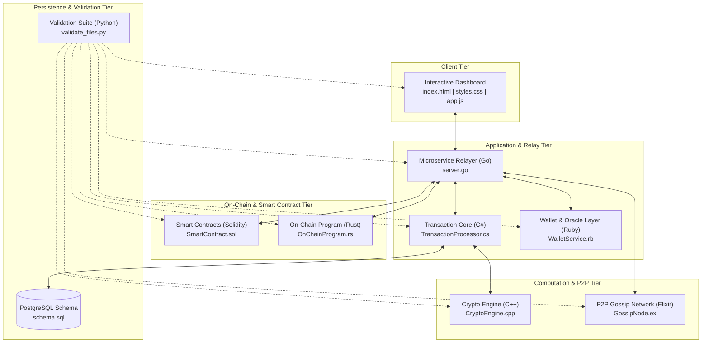

<div align="center">

# MAGNUM OPUS

### One repository. Nine languages. The entire Web3 stack.

*A multi-language, AI-assisted architectural showcase demonstrating how modern Web3, DeFi, and blockchain systems integrate across frontend, backend, engine, contract, data, and peer-to-peer gossip layers.*

[](LICENSE)
[](#project-status-read-this-first)
[](SECURITY.md)
[](https://github.com/LinkHAckerman/MasterProject/actions)

**[Live Dashboard Demo](https://linkhackerman.github.io/MasterProject/index.html) | [Contribute](CONTRIBUTING.md) | [Security](SECURITY.md)**

</div>

---

## Table of Contents

1. [Overview](#overview)
2. [Project Status: Read This First](#project-status-read-this-first)
3. [Architecture & Component Map](#architecture--component-map)
4. [Repository Layout](#repository-layout)
5. [Quick Start & Validation](#quick-start--validation)
6. [Automation and AI Agent Pipeline](#automation-and-ai-agent-pipeline)
7. [Project Documents](#project-documents)
8. [Known Limitations](#known-limitations)
9. [Roadmap](#roadmap)
10. [Contributing](#contributing)
11. [License](#license)

---

## Overview

**Magnum Opus** is an architectural reference implementation bringing together each tier of a Web3 platform into a single repository (`LinkHAckerman/MasterProject`). Each component is authored in an idiomatic language suited for its specific workload and performance profile:

| Layer | Language | Source File | Role |
|---|---|---|---|
| **Frontend Dashboard** | HTML5 / CSS3 / JavaScript | `index.html`, `styles.css`, `app.js` | Dark-theme Web3 trading, staking, portfolio, and swap interface |
| **Core Ledger & Processing** | C# (.NET) | `TransactionProcessor.cs` | Transaction lifecycle validation, Merkle block generation, cryptographic receipts |
| **High-Performance Engine** | C++ (C++20) | `CryptoEngine.cpp` | SHA-256 computation, Merkle tree verification, AMM math, order-book matching |
| **Smart Contracts** | Solidity (0.8.20+) | `SmartContract.sol` | Multi-token vault, AMM swap liquidity pools, yield staking, NFT badge logic |
| **Microservice Relayer** | Go (Golang) | `server.go` | Lightweight concurrent transaction relayer, wallet proxy, and WebSocket broadcaster |
| **Data Persistence** | PostgreSQL / SQL | `schema.sql` | Relational ledger schema for accounts, transactions, order books, and NFT metadata |
| **On-Chain Program** | Rust (Solana / Anchor) | `OnChainProgram.rs` | Memory-safe on-chain vault program with account state validation and instruction routing |
| **Glue & Oracle Layer** | Ruby | `WalletService.rb` | Balance aggregation, rate caching, mock oracles, and cross-tier transaction utilities |
| **P2P Gossip Network** | Elixir (OTP) | `GossipNode.ex` | Supervised peer-to-peer gossip node, OTP GenServer mempool, peer discovery and registry |
| **Validation & Automation** | Python 3 | `validate_files.py`, `ai_agent*.py` | Multi-model agent automation pipeline and syntax validation test suite |

---

## Project Status: Read This First

Magnum Opus is an **educational and architectural demonstration**, not a commercial or production deployment:

- **Educational Reference:** Components are functional, source-complete implementations designed to illustrate multi-language blockchain patterns. Most components operate as standalone units or mock integration harnesses.
- **Not Audited:** The Solidity smart contracts, Rust on-chain program, C++ cryptographic primitives, Go microservice, Elixir gossip node, and wallet relayers have **not undergone formal third-party audits**. **Do not deploy with real digital assets or private keys.** Consult [SECURITY.md](SECURITY.md) and [TERMS.md](TERMS.md).
- **AI-Assisted Development:** Files in this repository are collaboratively developed and refined with AI agent workflows (`ai_agent*.py`). Continuous syntax and integrity validation is performed via `validate_files.py`.
- **Simulated Market Environment:** Market rates, liquidity metrics, and transaction receipts rendered in the web dashboard are simulated demonstrations.

---

## Architecture & Component Map



### Detailed Component Roles

- **`index.html` / `styles.css` / `app.js`**: Web3 dark-theme frontend interface for monitoring wallet balances, transaction logs, liquidity pools, and executing simulated crypto swaps.
- **`CryptoEngine.cpp`**: C++20 computational engine executing high-throughput SHA-256 block hashing, Merkle tree construction, and order matching logic.
- **`TransactionProcessor.cs`**: C# .NET core ledger service handling transaction channels, batch validation, lock-free concurrency, and block generation.
- **`SmartContract.sol`**: Solidity smart contract suite implementing ERC20 tokens (`MagnumOpusToken`) and ERC721 NFTs (`MagnumOpusNFT`) with role-based controls, staking, and vault features.
- **`server.go`**: Go microservice providing HTTP and WebSocket endpoints for wallet transaction relaying, rate-limiting, and signature verification.
- **`schema.sql`**: Comprehensive PostgreSQL relational schema defining tables, indexes, triggers, and foreign keys for transactions, accounts, and market depth.
- **`OnChainProgram.rs`**: Solana Anchor Rust program managing on-chain vault accounts, authority signatures, and balance transfers.
- **`WalletService.rb`**: Ruby utility service providing currency conversions, oracle rate aggregation, and mock transaction signing routines.
- **`GossipNode.ex`**: Elixir OTP application featuring a supervised P2P gossip server, GenServer mempool, peer registry, and transaction broadcast mechanisms.
- **`validate_files.py`**: Python script that validates syntax across all repository source files (JS, C++, C#, Solidity, Go, SQL, Rust, Ruby, Elixir).
- **`ai_agent.py` & provider scripts**: Autonomous AI agents managing automated daily file enhancements and code generation across LLM providers.

---

## Repository Layout

```text
MasterProject/
├── .github/
│   └── workflows/
│       └── daily_agent.yml      # GitHub Actions daily agent workflow
├── .coauthors.tmp               # Temporary agent co-authors file
├── CLA.md                       # Contributor License Agreement
├── CODE_OF_CONDUCT.md           # Community Code of Conduct
├── CONTRIBUTING.md              # Contribution Guidelines
├── CryptoEngine.cpp             # C++20 Crypto & Order Matching Engine
├── GossipNode.ex                # Elixir OTP P2P Gossip Node & Mempool
├── LICENSE                      # MIT License
├── OnChainProgram.rs            # Rust Solana / Anchor On-Chain Program
├── README.md                    # Project Documentation
├── SECURITY.md                  # Security Policy and Vulnerability Disclosure
├── SmartContract.sol            # Solidity Smart Contract Suite
├── TERMS.md                     # Terms of Service & Disclaimer
├── TransactionProcessor.cs      # C# .NET Core Ledger Processor
├── WalletService.rb             # Ruby Wallet & Oracle Service
├── agent_common.py              # Shared Python agent utilities
├── ai_agent.py                  # Primary Python AI agent pipeline
├── ai_agent_cloudflare.py       # Cloudflare AI model provider agent
├── ai_agent_github_models.py    # GitHub Models provider agent
├── ai_agent_groq.py             # Groq provider agent
├── ai_agent_mistral.py          # Mistral AI provider agent
├── ai_agent_openrouter.py       # OpenRouter provider agent
├── app.js                       # Frontend Application Logic
├── index.html                   # Web3 Dashboard UI
├── scaffold/
│   └── test.txt                 # Test scaffold reference
├── schema.sql                   # PostgreSQL Database Schema
├── server.go                    # Go Transaction Relayer & Server
├── styles.css                   # Dark-Theme CSS Stylesheet
└── validate_files.py            # Integrity and Syntax Validation Script
```

---

## Quick Start & Validation

### 1. Clone the Repository

```bash
git clone https://github.com/LinkHAckerman/MasterProject.git
cd MasterProject
```

### 2. Validate Source Files

Run the syntax validator script to ensure all components pass format and syntax checks:

```bash
python3 validate_files.py
```

### 3. Launch Frontend Dashboard

Open `index.html` directly in any standard Web browser, or serve it using Python's built-in HTTP server:

```bash
python3 -m http.server 8000
```

Then visit `http://localhost:8000` in your web browser.

---

## Automation and AI Agent Pipeline

This repository incorporates an automated maintenance and enhancement pipeline driven by Python scripts (`ai_agent.py`, `ai_agent_*.py`, `agent_common.py`) executed via GitHub Actions (`.github/workflows/daily_agent.yml`).

The agent pipeline:
1. Selects source files based on recency and maintenance needs.
2. Formats requests for supported AI providers (GitHub Models, Groq, Mistral, OpenRouter, Cloudflare).
3. Evaluates changes using `validate_files.py` to ensure code integrity before committing updates.

---

## Project Documents

- **[LICENSE](LICENSE)**: MIT License terms.
- **[CONTRIBUTING.md](CONTRIBUTING.md)**: Guidelines for contributing code and improvements.
- **[CLA.md](CLA.md)**: Contributor License Agreement.
- **[SECURITY.md](SECURITY.md)**: Security policy, threat model, and reporting guidelines.
- **[TERMS.md](TERMS.md)**: Terms of service and usage disclaimers.
- **[CODE_OF_CONDUCT.md](CODE_OF_CONDUCT.md)**: Community standards and rules of behavior.

---

## Known Limitations

- **Multi-Language Execution Integration**: Individual source files (`CryptoEngine.cpp`, `TransactionProcessor.cs`, `SmartContract.sol`, `server.go`, `schema.sql`, `OnChainProgram.rs`, `WalletService.rb`, `GossipNode.ex`) represent standalone architectural reference implementations rather than a unified single-binary runtime.
- **Simulated RPC & Chain States**: The frontend dashboard communicates with local mock state handlers rather than live mainnet RPC nodes.
- **Non-Audited Security**: Code is designed for educational exploration and architectural design patterns; it has not been audited by third-party security firms.

---

## Roadmap

- **Planned**: Integration of automated unit test suites for individual language components.
- **Planned**: Docker Compose configuration for orchestrating local service execution.
- **Planned**: Enhanced WebAssembly (WASM) build targets for executing C++ and Rust engines directly in the browser.

---

## Contributing

We welcome community contributions! Please review [CONTRIBUTING.md](CONTRIBUTING.md) and [CLA.md](CLA.md) before submitting pull requests or opening issues.

---

## License

This project is open-source software licensed under the [MIT License](LICENSE).
