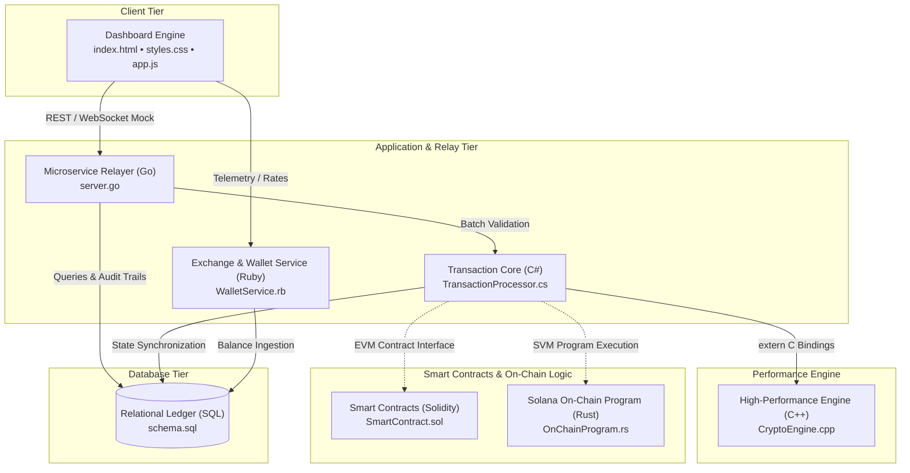

<div align="center">

# ⚡ MAGNUM OPUS

### One repository. Eight languages. The entire Web3 stack.

*A multi-language, AI-assisted showcase of how a crypto platform fits together, from the browser dashboard down to the on-chain program.*

[](https://github.com/LinkHAckerman/MasterProject/blob/main/LICENSE)
[](#-project-status-read-this-first)
[](SECURITY.md)
[](#-automation-and-ai-agent-pipeline)
[](https://github.com/LinkHAckerman/MasterProject/actions)
[](https://github.com/LinkHAckerman/LinkHAckerman/blob/main/header.svg)


**[🌐 Live dashboard demo](https://linkhackerman.github.io/MasterProject/index.html) · [🤝 Contribute](CONTRIBUTING.md) · [🔐 Security](SECURITY.md)**

</div>

---

## 📚 Table of Contents

1. [Overview](#-overview)
2. [Project status: read this first](#-project-status-read-this-first)
3. [Architecture](#-architecture)
4. [Component map](#-component-map)
5. [Quick start](#-quick-start)
6. [Automation and AI agent pipeline](#-automation-and-ai-agent-pipeline)
7. [Repository layout](#-repository-layout)
8. [Project documents](#-project-documents)
9. [Known limitations](#-known-limitations)
10. [Roadmap](#-roadmap)
11. [Contributing](#-contributing)
12. [License](#-license)

---

## 🌐 Overview

**Magnum Opus** is an architectural showcase bringing together each tier of a modern crypto and Web3 system within a single repository, implementing each module in an idiomatic language suited for the domain:

| Layer | Language | Role |
|------|----------|------|
| Frontend Dashboard | **HTML5 / CSS3 / JavaScript (ES6+)** | Responsive dark-theme Web3 trading, staking, portfolio, and swap interface |
| Core Ledger & Processing | **C# (.NET Core)** | High-throughput transaction engine, block generation, cryptographic receipts |
| Computational Engine | **C++ (C++20)** | High-performance SHA-256, Merkle tree verification, AMM math, order-book matching |
| Smart Contracts | **Solidity (0.8.24)** | ERC-20 tokenomics, automated market maker (AMM) DEX, yield staking pool |
| Microservice API | **Go (Golang)** | Concurrency-focused wallet proxy, transaction relayer, rate-limited HTTP/WebSocket service |
| Data Persistence Layer | **SQL (PostgreSQL)** | Relational schema for multi-chain balances, audit logs, order books, NFT registries |
| On-Chain Program | **Rust (Solana / Anchor)** | Memory-safe on-chain vault program with account state validation and instruction routing |
| Glue & Aggregation Service | **Ruby** | Real-time exchange-rate aggregation, wallet balance caching, and cross-tier helpers |
| Automation & Validation | **Python** | Multi-provider agent scripts and continuous validation test suites |

---

## ⚠️ Project status: read this first

Magnum Opus is an **educational and architectural demonstration**, not a commercial or production deployment:

- **Demo-grade implementations:** Components are functional, source-complete implementations designed to illustrate multi-language blockchain patterns. Most components operate as standalone units or mock integration harnesses.
- **Not audited:** The Solidity smart contracts, Rust on-chain program, C++ cryptographic primitives, and wallet relayers have **not undergone formal third-party audits**. **Do not deploy with real digital assets or private keys.** Consult [SECURITY.md](SECURITY.md) and [TERMS.md](TERMS.md).
- **AI-assisted development:** Files are refined through automated and collaborative AI workflows. Continuous syntax and integrity validation is performed via `validate_files.py`.
- **Simulated market environment:** Market rates, liquidity metrics, and transaction receipts rendered in the web dashboard are simulated demonstrations.

---

## 🏗️ Architecture



The C++ cryptographic module implements exported C-linkage APIs (`extern "C"`) designed for Foreign Function Interface (FFI) bindings with the C# backend (`P/Invoke`) and Go services (`cgo`).

---

## 📦 Component map

| Component | Technology | Primary File | Description |
|-----------|------------|--------------|-------------|
| **Client Dashboard** | HTML5 / CSS3 / Vanilla JS | `index.html`, `styles.css`, `app.js` | Interactive dark-mode dashboard featuring portfolio telemetry, swap simulator, staking interface, order book canvas, and audio feedback. |
| **Core Transaction Processor** | C# (.NET) | `TransactionProcessor.cs` | In-memory blockchain engine with thread-safe pending pools, SHA-256 block mining, Merkle roots, and JSON ledger persistence. |
| **High-Performance Engine** | C++ (C++20) | `CryptoEngine.cpp` | Merkle tree builder, fast SHA-256 hasher, constant-product AMM computation, and in-memory limit order book matching engine. |
| **Smart Contracts** | Solidity (0.8.24) | `SmartContract.sol` | Decentralized application suite comprising ERC-20 token with mint/burn, multi-tier yield staking pool, and automated constant-product swap. |
| **Relayer Service** | Go 1.20+ | `server.go` | HTTP/WebSocket microservice with route multiplexing, rate-limiting tokens, cryptographic payload validation, and in-memory wallet ledger. |
| **Database Schema** | PostgreSQL | `schema.sql` | Production-ready schema featuring UUID primary keys, cryptographic verification digests, users, wallets, token balances, and audit trails. |
| **On-Chain Vault** | Rust (Solana/Anchor) | `OnChainProgram.rs` | Program Derived Address (PDA) vault supporting authority-managed deposits, fee calculations, time-locked withdrawals, and emitted events. |
| **Wallet & Rates Service** | Ruby 3.x | `WalletService.rb` | High-precision `BigDecimal` arithmetic, external rate aggregation, cache invalidation, and thread-safe balance operations. |
| **Validation Engine** | Python 3.9+ | `validate_files.py` | Automated syntax, structure, and integrity validation harness for all repository source files. |
| **Automation Suite** | Python 3.9+ | `agent_common.py`, `ai_agent*.py` | Modular multi-LLM automation harness supporting multiple AI inference backends for repository maintenance. |

---

## 🚀 Quick start

### 1. Clone the repository

```bash
git clone https://github.com/LinkHAckerman/MasterProject.git
cd MasterProject
```

### 2. Launch the web dashboard

Open `index.html` directly in any modern browser, or launch a local static HTTP server:

```bash
# Using Python built-in HTTP server
python3 -m http.server 8080
# Open http://localhost:8080 in your browser
```

### 3. Run the validation harness

Validate source integrity, encoding, and syntax across all project files:

```bash
python3 validate_files.py
```

### 4. Exploring individual language tiers

Each layer can be inspected or checked with its native toolchain:

- **Go Microservice (`server.go`):**
  ```bash
  go run server.go
  ```
- **C++ Engine (`CryptoEngine.cpp`):**
  ```bash
  g++ -std=c++20 -O3 -Wall CryptoEngine.cpp -o crypto_engine
  ./crypto_engine
  ```
- **C# Ledger Core (`TransactionProcessor.cs`):**
  ```bash
  dotnet build  # When paired with a .NET project definition
  ```
- **Ruby Service (`WalletService.rb`):**
  ```bash
  ruby WalletService.rb
  ```
- **PostgreSQL Database (`schema.sql`):**
  ```bash
  psql -U postgres -d postgres -f schema.sql
  ```

---

## 🤖 Automation and AI agent pipeline

The project uses an automated maintenance workflow orchestrated through GitHub Actions and Python driver scripts:

- **Workflow:** `.github/workflows/daily_agent.yml` executes scheduled runs to review and refine individual codebase layers.
- **Common Harness:** `agent_common.py` encapsulates file parsing, snapshot serialization, and prompt configuration.
- **Provider Implementations:** Provider-specific AI agents handle different inference engines:
  - `ai_agent.py` / `ai_agent_github_models.py`
  - `ai_agent_cloudflare.py`
  - `ai_agent_groq.py`
  - `ai_agent_mistral.py`
  - `ai_agent_openrouter.py`
- **Validation Engine:** `validate_files.py` guarantees that updates maintain parseable syntax and follow code style standards.

---

## 📁 Repository layout

```
MasterProject/
├── .github/
│   └── workflows/
│       └── daily_agent.yml       # Automated CI workflow configuration
├── scaffold/
│   └── test.txt                  # Test harness scaffolding data
├── index.html                    # Frontend HTML5 trading and portfolio dashboard
├── styles.css                    # Glass-morphism responsive CSS design system
├── app.js                        # Client-side state manager, charts, and simulation logic
├── TransactionProcessor.cs       # C# core transaction, ledger, and block producer
├── CryptoEngine.cpp              # C++ high-performance matching, hashing, and math
├── SmartContract.sol             # Solidity contracts (ERC-20, Staking, AMM DEX)
├── server.go                     # Go REST/WebSocket transaction relayer microservice
├── schema.sql                    # PostgreSQL relational database schema
├── OnChainProgram.rs             # Solana/Anchor on-chain vault program
├── WalletService.rb              # Ruby multi-currency balance and rate caching service
├── validate_files.py             # Integrity and syntax checker script
├── agent_common.py               # Shared utility logic for automation agents
├── ai_agent.py                   # Primary automated agent script
├── ai_agent_cloudflare.py        # Cloudflare Workers AI integration agent
├── ai_agent_github_models.py     # GitHub Models integration agent
├── ai_agent_groq.py              # Groq high-speed inference integration agent
├── ai_agent_mistral.py           # Mistral AI integration agent
├── ai_agent_openrouter.py        # OpenRouter multi-model integration agent
├── CLA.md                        # Contributor License Agreement
├── CODE_OF_CONDUCT.md            # Contributor covenant code of conduct
├── CONTRIBUTING.md               # Contribution and pull request guidelines
├── LICENSE                       # MIT License notice
├── README.md                     # Public repository documentation
├── SECURITY.md                   # Security reporting and vulnerability policy
└── TERMS.md                      # Usage terms, disclaimer, and liabilities
```

---

## 📄 Project documents

Please review our governance, legal, and operational documents:

- [LICENSE](LICENSE) — Official MIT License terms.
- [CONTRIBUTING.md](CONTRIBUTING.md) — Guidelines for code contributions, workflow, and testing.
- [CLA.md](CLA.md) — Contributor License Agreement.
- [SECURITY.md](SECURITY.md) — Vulnerability reporting and security considerations.
- [TERMS.md](TERMS.md) — Disclaimers, software usage conditions, and risk warnings.
- [CODE_OF_CONDUCT.md](CODE_OF_CONDUCT.md) — Community standards and participant expectations.

---

## 🔍 Known limitations

- **Simulated Cross-Chain IPC:** Direct Inter-Process Communication (IPC) between the Go relayer, C# backend, and C++ engine relies on standalone mocks rather than live dynamic shared library bindings.
- **Simulated Chain Feeds:** The client dashboard generates synthetic price and liquidity movements on intervals rather than consuming live Ethereum/Solana RPC nodes.
- **Database Connectivity:** Services currently hold in-memory stubs instead of binding directly to a live PostgreSQL cluster during quick-start executions.

---

## 🗺️ Roadmap

*The following milestones reflect planned technical iterations:*

- [ ] **Cross-Language FFI:** Build CMake and build script pipelines to compile `CryptoEngine.cpp` to a shared object (`.so` / `.dll`) consumed by `TransactionProcessor.cs` (P/Invoke) and `server.go` (cgo).
- [ ] **Live RPC Provider Hook:** Optional client-side RPC provider toggle (MetaMask / Phantom) within `app.js` for on-chain state inspection.
- [ ] **Unified Docker Harness:** Containerize the Go, C#, and PostgreSQL environments for integrated one-command orchestration.
- [ ] **Automated Test Coverage:** Expand `validate_files.py` to invoke native test runners (`go test`, `dotnet test`, `cargo test-bpf`) in CI runners.

---

## 🤝 Contributing

Contributions are welcome! Whether filing issues, submitting pull requests, or improving documentation, please consult [CONTRIBUTING.md](CONTRIBUTING.md) and ensure that `python3 validate_files.py` passes cleanly prior to opening a PR.

---

## 📜 License

This project is distributed under the terms of the **MIT License**. Refer to [LICENSE](LICENSE) for the full text.
