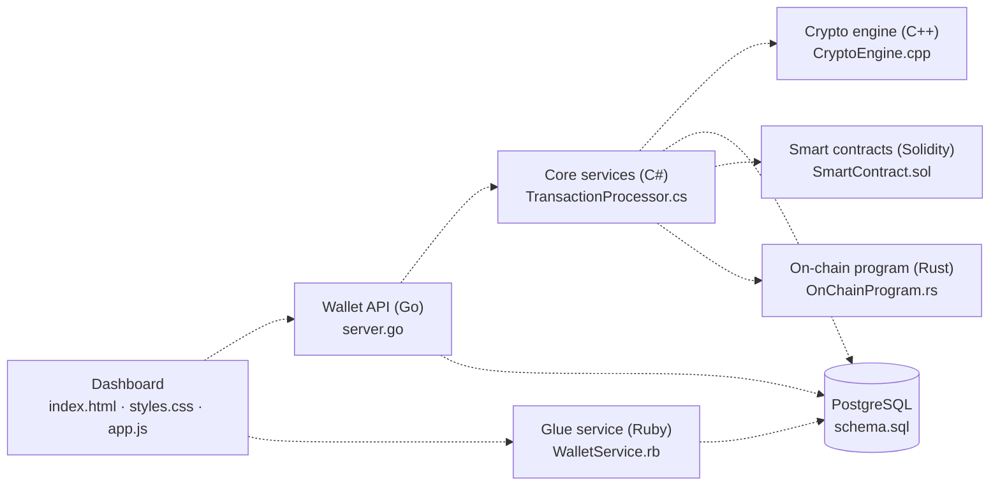

<div align="center">

# ⚡ MAGNUM OPUS

### One repository. Eight languages. The entire Web3 stack.

*A multi-language, AI-assisted showcase of how a crypto platform fits together, from the browser dashboard down to the on-chain program.*

[](LICENSE)
[](#-project-status-read-this-first)
[](SECURITY.md)
[](#-the-autonomous-development-pipeline)

**[🌐 Live dashboard demo](https://linkhackerman.github.io/MasterProject/index.html)** · **[🤝 Contribute](CONTRIBUTING.md)** · **[🔐 Security](SECURITY.md)**

</div>

---

## 📚 Table of Contents

1. [Overview](#-overview)
2. [Project status: read this first](#-project-status-read-this-first)
3. [Architecture](#-architecture)
4. [Component map](#-component-map)
5. [Component deep dives](#-component-deep-dives)
6. [Quick start](#-quick-start)
7. [The autonomous development pipeline](#-the-autonomous-development-pipeline)
8. [Known limitations](#-known-limitations)
9. [Roadmap](#-roadmap)
10. [Repository layout](#-repository-layout)
11. [Project documents](#-project-documents)
12. [Disclaimer](#-disclaimer)

---

## 📖 Overview

**Magnum Opus** is an ambitious, ever-evolving attempt to put every layer of a modern crypto platform into a single repository, each layer written in the language best suited to the job:

| Layer | Language | Role |
| --- | --- | --- |
| Dashboard | **HTML / CSS / JavaScript** | A dark-theme trading and portfolio dashboard |
| Core services | **C# (.NET)** | Transaction validation, block production, receipts |
| Performance engine | **C++** | Hashing, Merkle proofs, order matching, AMM math |
| Smart contracts | **Solidity** | Token, staking vault, constant-product DEX |
| Microservice | **Go** | Wallet and transfer REST API |
| Data layer | **SQL (PostgreSQL)** | Users, wallets, assets, NFTs, DeFi history, audit logs |
| On-chain program | **Rust (Anchor/Solana)** | A vault program with deposits, withdrawals and events |
| Glue layer | **Ruby** | Exchange rates, conversions and wallet data helpers |

The goal is to demonstrate **breadth, systems thinking and craft across ecosystems**. It is a living project: parts of it are written, reviewed and committed every day by a team of AI agents under the maintainer's direction (see [the pipeline](#-the-autonomous-development-pipeline)).

---

## 🚦 Project status: read this first

Magnum Opus is a **showcase and learning project, not a product**. Please keep the following in mind:

- 🧪 **Demo-grade code.** Components are real, readable implementations, but most are standalone modules that are **not yet wired together** into a running end-to-end system.
- 🔓 **Not audited.** The contracts, on-chain program, wallet logic and cryptographic routines have had **no independent security review**. **Never use this code with real funds.** See [SECURITY.md](SECURITY.md) and [TERMS.md](TERMS.md).
- 🤖 **AI-assisted and changing daily.** Content is generated and revised by automated agents and checked only by basic automated validation. Expect rough edges. See [Known limitations](#-known-limitations) for an honest list.
- 🚫 **No financial advice.** Nothing here is investment advice or an offer of any asset. All market data in the dashboard is simulated.

Status legend used below: ✅ implemented · 🧪 demo-grade · 🚧 needs work

---

## 🧩 Architecture

The diagram shows the **intended** architecture. Every arrow is a planned integration that is not yet implemented; the boxes are the components that exist in this repository today.



The C++ engine exposes a C-linkage API (`extern "C"`) specifically so the C# and Go layers can call into it later through P/Invoke or cgo.

---

## 📋 Component map

| File | Language | What is in it today | Status |
| --- | --- | --- | --- |
| `index.html` | HTML | Dark "glass" dashboard: portfolio metrics, charts, order book, wallet panel, trade form, wallet modal | 🧪 |
| `styles.css` | CSS | Shared stylesheet for the dashboard | 🧪 |
| `app.js` | JavaScript | Client-side state store, simulated market, gas and order-book feeds, notifications, settings | 🧪 |
| `CryptoEngine.cpp` | C++ | Keccak-256, Bloom filter, Merkle trees and proofs, limit-order-book matching engine, AMM math, block validator, gas-priority mempool, C API | 🧪 |
| `TransactionProcessor.cs` | C# | Transaction, block, wallet and receipt models; validation; pending queue; background block production with a demo proof-of-work | 🧪 |
| `SmartContract.sol` | Solidity | ERC-20 token, staking vault with reward streaming, constant-product AMM/DEX | 🧪 |
| `server.go` | Go | In-memory wallet REST API with logging and CORS middleware and graceful shutdown | 🧪 |
| `schema.sql` | SQL | PostgreSQL schema for users, wallets, assets, NFTs, transactions, DeFi activity, staking, pools, audit logs | 🚧 |
| `OnChainProgram.rs` | Rust | Anchor-style vault program: initialize, deposit, withdraw, change authority, with events and checked math | 🚧 |
| `WalletService.rb` | Ruby | Exchange-rate lookups (CoinGecko), asset conversion, mocked balance, history and NFT helpers | 🧪 |

---

## 🔬 Component deep dives

### 🎨 Dashboard (`index.html`, `styles.css`, `app.js`)
- A responsive dark theme with gradient accents and glass-style cards.
- Portfolio metric cards, a performance chart (Chart.js loaded from a CDN), an order book, a wallet and asset panel, a trade form with limit, market and stop-limit tabs, a connect-wallet modal and toast notifications.
- `app.js` contains a state store, simulated price, gas and order-book feeds, settings persisted in `localStorage`, optional Web Audio cues and a `postMessage` hook for Web3 events.
- **All data is simulated.** No real wallet connection or market feed exists yet.

### 🔧 Crypto engine (`CryptoEngine.cpp`)
- **Keccak-256** (the hash used by Ethereum) implemented from the permutation up.
- **Bloom filter** in the style of Ethereum's 2048-bit log bloom.
- **Merkle tree engine**: root calculation, proof generation and proof verification.
- **Limit order book**: price-time priority matching for limit and market orders, cancellations, depth, spread and mid-price.
- **AMM math**: constant-product swap in/out, price impact, impermanent loss, and Uniswap-v3-style tick and sqrt-price conversions.
- **Block validator**: previous-hash link, Merkle root, header hash and a leading-zero difficulty check.
- **Mempool**: thread-safe, gas-price priority ordering with nonce checks.
- **C interface** (`extern "C"`) for hashing and AMM calculations, intended for use from other languages.
- ⚠️ The class named `Sha256` is a fast **non-cryptographic** FNV-based mixer, not SHA-256. It is used internally for demos and must not be relied on for security. Replacing it with a real SHA-256 is on the roadmap.

### 🧱 Core services (`TransactionProcessor.cs`)
- Strongly typed models (`Transaction`, `TransactionReceipt`, `Block`, `Wallet`, `Token`, `NodeStats`) with JSON attribute mapping.
- `TransactionProcessor` validates and queues transactions, produces a block on a timer, mines it with a deliberately naive proof-of-work and records receipts.
- Signatures are **placeholders** (a hash of the payload), and there is no persistence or API host yet.

### 📜 Smart contracts (`SmartContract.sol`)
- **`MagnumOpusToken`**: an ERC-20 style token (`MOPUS`, 18 decimals) with owner-only minting and public burning.
- **`MagnumOpusStakingVault`**: stake a token and earn a reward token streamed at a configurable per-second rate.
- **`MagnumOpusDEX`**: a constant-product pool with liquidity shares, a 0.3% swap fee and a minimum-output slippage guard.
- Targets Solidity `^0.8.24`. The contracts are **unaudited** and have no formal test suite yet.

### 📡 Wallet API (`server.go`)
A small in-memory service built with `gorilla/mux`:

| Method | Path | Description |
| --- | --- | --- |
| `GET` | `/health` | Liveness check |
| `POST` | `/wallet` | Create a wallet `{ "address": "..." }` |
| `GET` | `/wallet/{address}` | Fetch a wallet and its balances |
| `POST` | `/wallet/{address}/transfer` | Transfer `{ "to", "token", "amount" }` |

Includes request logging, CORS headers and graceful shutdown on `SIGINT`/`SIGTERM`. Data is held in memory only and there is no authentication.

### 💾 Data layer (`schema.sql`)
A PostgreSQL schema covering users, multi-network wallets, tokens and NFTs (collections and tokens), balances, transactions with rich metadata, smart-contract and DeFi interactions, staking positions, liquidity pools, user preferences and audit logs, with supporting indexes and constraints.

### 🦀 On-chain program (`OnChainProgram.rs`)
An Anchor-style Solana vault: `initialize`, `deposit`, `withdraw` and `set_authority`, with checked arithmetic, custom errors and emitted events. It uses a placeholder program ID and still needs rework before it could run on a cluster (see [Known limitations](#-known-limitations)).

### 💎 Glue service (`WalletService.rb`)
Looks up exchange rates from the public CoinGecko API, converts amounts between assets and provides mocked balance, transaction-history and NFT helpers that show the intended interface.

---

## 🚀 Quick start

There is no single build command yet, because the components are standalone. Each one can be tried on its own. Clone the repository first:

```bash
git clone https://github.com/LinkHAckerman/MasterProject.git
cd MasterProject
```

### Dashboard
Open the live demo at **https://linkhackerman.github.io/MasterProject/index.html**, or open `index.html` locally in a browser.

### Go wallet API
Requires Go 1.21 or newer. The repository does not include a `go.mod` yet, so create one first:

```bash
go mod init magnumopus
go get github.com/gorilla/mux
go run server.go            # listens on :8080
curl localhost:8080/health
```

### C++ engine
The engine is a library without its own `main`. Write a small driver that includes it:

```cpp
// demo.cpp
#include "CryptoEngine.cpp"

int main() {
    using namespace MagnumOpus;
    std::cout << Keccak256::ComputeHash("hello") << "\n";
    std::cout << AmmMath::GetAmountOut(10.0, 1000.0, 2000.0) << "\n";
}
```

```bash
g++ -std=c++17 demo.cpp -o demo && ./demo
```

### Ruby service
Requires Ruby 3.1 or newer:

```bash
ruby -r./WalletService -e 'puts MagnumOpus::WalletService.new.get_usdt_balance'
```

### Other components
The C# processor, Solidity contracts, Rust program and SQL schema need their own project scaffolding (a .NET project, Hardhat or Foundry, an Anchor workspace and a PostgreSQL database respectively). That scaffolding is on the [roadmap](#-roadmap).

---

## 🤖 The autonomous development pipeline

Part of what makes this repository unusual is **how it is built**. A scheduled GitHub Actions workflow runs every day and lets several AI agents improve the code:

1. **Five AI agents** (Gemini, Groq, Mistral, OpenRouter and Cloudflare Workers AI) each receive the project goal and a snapshot of the codebase.
2. **Stalest-first rotation.** Each agent is assigned the file that has gone the longest without an update (using git history), so every file gets attention in turn.
3. **Collision-free.** Agents record which file they claimed so two agents never edit the same file in one run.
4. **Cooldown for the README.** This file is rewritten at most once a week, and the pipeline always keeps the accurate links and URLs below.
5. **Automatic validation.** Generated files are syntax-checked (Python, JavaScript, Go, C++ and Ruby; SQL and Rust as advisory checks). A file that fails validation is **reverted**, so a bad generation never lands.
6. **Committed under the maintainer's identity** and pushed to `main`.

| File | Purpose |
| --- | --- |
| `.github/workflows/daily_agent.yml` | The daily schedule and job definition |
| `agent_common.py` | Shared logic: file rotation, prompts, retries, JSON parsing, README guardrails |
| `ai_agent.py`, `ai_agent_groq.py`, `ai_agent_mistral.py`, `ai_agent_openrouter.py`, `ai_agent_cloudflare.py` | One script per AI provider |
| `ai_agent_github_models.py` | Retired provider, kept for reference and no longer run |
| `validate_files.py` | Syntax validation and automatic revert of bad files |

Because the code is AI-assisted, **review and test anything before relying on it.**

---

## 🔎 Known limitations

Honesty is part of professionalism. These are the known gaps today:

- **No automated tests yet.** There are no unit-test suites, and no continuous build of the C#, Solidity or Rust code.
- **Components are not integrated.** There is no running end-to-end stack, no Docker setup and no deployment configuration.
- **Dashboard wiring.** `app.js` looks up element IDs that do not yet match those in `index.html`, and the page currently ships inline styles rather than linking `styles.css`. The dashboard renders, but the scripted interactions are unfinished.
- **`CryptoEngine.cpp`.** The `Sha256` class is not a real SHA-256 (see above).
- **`schema.sql`.** The `transactions` table refers to a `tx_status` type that is not yet defined, so the file will not run as-is on PostgreSQL.
- **`OnChainProgram.rs`.** Deposits and withdrawals adjust lamport balances directly instead of using a system-program transfer, and the program ID is a placeholder. There is no `Cargo.toml` or Anchor workspace yet.
- **`WalletService.rb`.** Balances, history and NFT data are mocked, and the network error fallback needs rework.
- **`server.go`.** In-memory storage, no authentication and a permissive CORS policy. It is for local experimentation only.
- **`TransactionProcessor.cs`.** Placeholder signatures and no persistence.
- **`SmartContract.sol`.** No audit and no automated tests, and the contracts have not been hardened (for example against reentrancy).

---

## 🧭 Roadmap

Planned work, **not yet implemented**:

- [ ] Replace the placeholder hash with real SHA-256 and add C++ unit tests (GoogleTest).
- [ ] Add project scaffolding and CI builds for C# (.NET), Rust (Anchor) and Solidity (Hardhat or Foundry).
- [ ] Add test suites for each language and run them in continuous integration.
- [ ] Fix the `schema.sql` type definition and add migrations.
- [ ] Align the dashboard markup, styles and script, then connect it to the Go API.
- [ ] Add a `go.mod`, authentication and persistence to the wallet API.
- [ ] Containerize the services with Docker Compose.
- [ ] Wire the components together through the interfaces shown in the architecture diagram.

---

## 📂 Repository layout

```
MasterProject/
├── .github/workflows/daily_agent.yml   # Daily automation
├── index.html  styles.css  app.js      # Dashboard
├── CryptoEngine.cpp                    # C++ engine
├── TransactionProcessor.cs             # C# core services
├── SmartContract.sol                   # Solidity contracts
├── server.go                           # Go wallet API
├── schema.sql                          # PostgreSQL schema
├── OnChainProgram.rs                   # Rust on-chain program
├── WalletService.rb                    # Ruby glue service
├── agent_common.py  ai_agent*.py       # AI agent scripts
├── validate_files.py                   # Validation and revert
├── LICENSE  CONTRIBUTING.md  CLA.md
└── SECURITY.md  TERMS.md  CODE_OF_CONDUCT.md
```

---

## 📑 Project Documents

- [License](LICENSE): MIT
- [Contributing](CONTRIBUTING.md): how to get involved
- [Contributor License Agreement](CLA.md): terms for contributions
- [Security Policy](SECURITY.md): how to report vulnerabilities
- [Terms of Use](TERMS.md): rules for using this project
- [Code of Conduct](CODE_OF_CONDUCT.md): how we treat each other

### 🤝 Contributing

Contributions are welcome. Please read [CONTRIBUTING.md](CONTRIBUTING.md) and the [Contributor License Agreement](CLA.md), fork the repository, make a focused change and open a pull request. All participants are expected to follow the [Code of Conduct](CODE_OF_CONDUCT.md).

---

## 📄 Disclaimer

Magnum Opus is provided **as is**, for demonstration and education only. It is not audited, not production software and not financial advice. Do not use it with real funds. See the [Terms of Use](TERMS.md) and the [MIT License](LICENSE) for details.

<div align="center">

**Built in the open, one commit at a time.**

</div>
